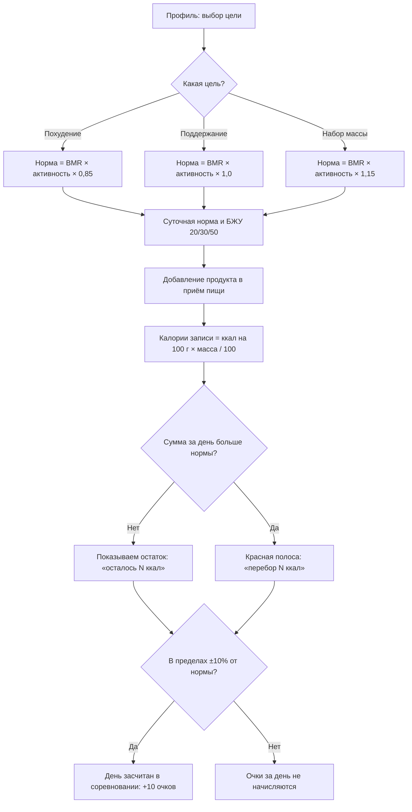

# Калькулятор калорий — Android-приложение (версия 0.2)

Kotlin + Jetpack Compose, архитектура MVVM, локальная база Room. Сервер пока не подключён: справочник продуктов лежит в коде, а дневник, профиль, свои продукты и соревнование сохраняются в базу на телефоне и не пропадают после закрытия приложения.

## Как открыть и запустить

1. Установить **Android Studio** (бесплатно, developer.android.com/studio). При первом запуске согласиться на установку Android SDK.
2. Распаковать архив, в Android Studio выбрать **File → Open** и указать папку `CaloriesApp` (ту, где лежит `settings.gradle.kts`).
3. Подождать, пока пройдёт **Gradle Sync** (полоса внизу окна). В первый раз скачиваются библиотеки, это 3–10 минут, нужен интернет.
   - Если студия предложит установить недостающий SDK Platform 34, нажать **Install**.
   - Если предложит обновить Android Gradle Plugin (AGP Upgrade Assistant), можно отказаться: проект собирается и так.
4. Создать эмулятор: **Tools → Device Manager → «+» → Create Virtual Device** → например, Pixel 7 → образ системы с API 34 → Finish.
   Или подключить свой телефон по USB с включённой «Отладкой по USB» (в настройках разработчика).
5. Нажать зелёный **▶ Run 'app'** (Shift+F10). Приложение откроется в эмуляторе.

## Что можно потыкать

- **Вход**: кнопка «Войти как демо-пользователь» или любая почта и пароль от 6 символов. «Регистрация» сначала открывает анкету профиля. После входа приложение запоминает пользователя и при следующем запуске сразу открывает дневник.
- **Дневник**: калории и БЖУ за день, стрелками можно листать прошлые дни, компактные кнопки «+» у приёмов пищи, стаканы воды. В правом верхнем углу карточки — значок **«i»** с пояснением, как цель влияет на норму.
- **Приём пищи** (нажать на строку): изменить массу или удалить продукт.
- **Добавление**: поиск («греч»), масса кнопками −/+ или быстрыми чипами, «Итого» пересчитывается сразу.
- **Продукты**: справочник с категориями и кнопка «Свой продукт» (проверяет, сходятся ли калории с БЖУ).
- **Статистика**: день / неделя / месяц, график с линией нормы.
- **Рейтинг** — соревновательный режим: создать группу и получить код вида `KAL-1234` или вступить по коду друга. Очки за неделю: +10 за день в своей норме (±10%), +3 за 8 стаканов воды, +5 за каждый день серии от 3 дней подряд. Пока нет сервера, соперники — демо-участники, которые генерируются по коду группы.
- **Профиль**: норма пересчитывается по формуле Миффлина–Сан Жеора при любом изменении. Значки **«i»** у блока «Цель» и у карточки нормы объясняют расчёт.
- Значок **«синхронизировано»** в дневнике включает офлайн-режим: изменения копятся в очереди, при включении сети «отправляются».
- Чтобы проверить сохранение: добавьте продукт, полностью закройте приложение (смахнуть из недавних) и откройте снова — запись на месте.

Подсказка «i» открывается нажатием, долгим нажатием или наведением мыши (в эмуляторе).

## Как цель влияет на дневник



GitHub и Android Studio (с плагином Markdown) рисуют эту схему автоматически. Картинка той же схемы: `docs/goal-flow.png`.

## Тесты

- `NormCalculatorTest.kt` — расчёт нормы по формуле.
- `ScoringTest.kt` — очки в соревновании: зона нормы ±10%, вода, бонус за серию.

Запуск: правой кнопкой по папке `app/src/test` → **Run 'Tests in ...'**.

## Структура

```
app/src/main/java/ru/chsu/calories/
├── MainActivity.kt
├── data/
│   ├── Models.kt, ProductCatalog.kt, DemoData.kt
│   ├── Competition.kt    модели соревнования и демо-соперники
│   └── local/            Room: таблицы, DAO, база, репозиторий
├── domain/
│   ├── NormCalculator.kt расчёт нормы и БЖУ
│   └── Scoring.kt        очки в соревновании
└── ui/
    ├── AppViewModel.kt   состояние и логика (MVVM), загрузка и сохранение в Room
    ├── CaloriesApp.kt    навигация и нижнее меню
    ├── components/       общие элементы интерфейса, подсказка «i»
    ├── screens/          экраны
    └── theme/            цвета
```

## Что дальше

- ~~Room: сохранять дневник и профиль в локальную базу~~ — сделано в версии 0.2.
- Retrofit: запросы к REST API сервера (FastAPI) и авторизация по JWT.
- Синхронизация очереди изменений с сервером при появлении сети.
- Соревнование через сервер: настоящие участники вместо демо (`GET /competitions/{code}`).
